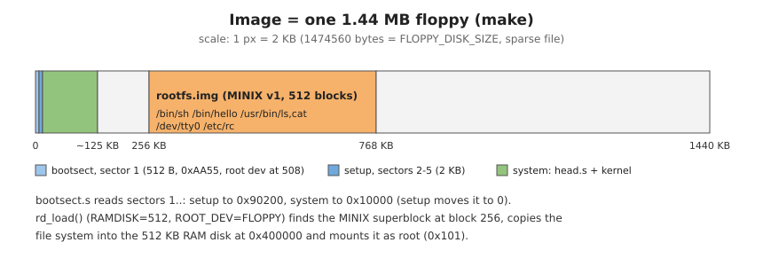
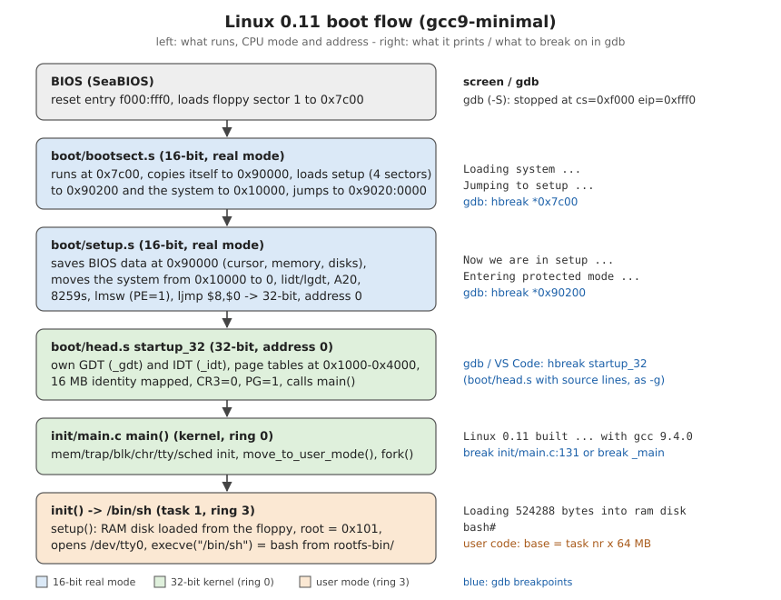
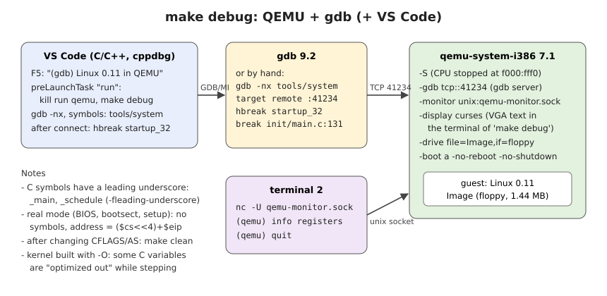

# Linux 0.11 with a modern GCC (branch `gcc9-minimal`)

The official Linux 0.11 source (December 8, 1991) built with today's host
tools and booted in QEMU - in many small commits, one step each. Every commit
subject reads `Phase X, step Y: ...` or `Phase X, test Tn: ...`, and every
commit carries [`plan.md`](plan.md) with the steps done up to that commit.
Reference port: oldlinux-0.11 (yuan-xy/Linux-0.11, from oldlinux.org); where it
does not fix a problem that is fixed here, the commit message says so.



*A recorded gdb session, replayed as an animated SVG: `make debug` in one terminal, `gdb` in another; it stops at `startup_32` in boot/head.s and at a source breakpoint in `init/main.c` (see [Debugging with gdb](#debugging-with-gdb)).*



*The same steps with [gdb-dashboard](https://github.com/cyrus-and/gdb-dashboard) (layout: source, assembly, registers, stack): every stop redraws the screen, so the source line, the instruction, the changed registers and the call stack can be followed from the reset entry to `main()`.*

## Environment

Tested on this host:

| Tool | Version | Used for |
|---|---|---|
| Ubuntu | 20.04.6 LTS | host |
| gcc | 9.4.0 | kernel C code (`-m32 -std=gnu89 -fleading-underscore -fno-pie -g ...`), tools/build |
| GNU binutils (as, ld, objcopy) | 2.34 | assembly (incl. the 16-bit boot code, `.code16`), linking, raw images |
| GNU make | 4.2.1 | build |
| QEMU | 7.1.0 (`qemu-system-i386`) | running and debugging |
| gdb | 9.2 | debugging |
| python3 | 3.8 | tools/minixfs.py, tools/mkaout.py (root file system, a.out wrapper) |
| netcat (OpenBSD) | 1.206 | QEMU monitor socket (`nc -U`) |
| VS Code + C/C++ extension | cpptools 1.17.5 | optional, graphical debugging (`.vscode/`) |

`bin86` (as86/ld86) is **not** needed: the boot sector and setup were
translated to GNU as syntax (phase 2).

## Build and run

```bash
make            # Image: 1.44 MB floppy = bootsect + setup + kernel + root file system
make run        # boot it in QEMU, VGA text screen in this terminal (-display curses)
```

`make run` ends at a `bash#` prompt (bash, ls, cat from `rootfs-bin/`). The
QEMU monitor is on a Unix socket - Alt-2/Esc 2 of the curses display does not
reach QEMU in a terminal:

```bash
nc -U qemu-monitor.sock        # second terminal, same directory
(qemu) info registers
(qemu) quit                    # ends QEMU
```

After changing compiler or assembler flags run `make clean` first: the 1991
Makefiles do not notice flag changes or changes inside the subdirectories.

### What is in the floppy image



### How it boots



## Debugging with gdb



`make debug` is `make run` plus `-S` (CPU stopped before the first
instruction) and `-gdb tcp::41234` (QEMU's gdb server). All assembly and C
code is built with `-g`, so gdb shows source lines; the raw `Image` does not
contain the debug sections.

### On the command line

```bash
make clean && make
make debug                                   # terminal 1: QEMU waits, black screen
gdb -ex 'target remote :41234' tools/system  # terminal 2
```

Started in this directory, gdb reads the project [`.gdbinit`](.gdbinit). If
[gdb-dashboard](https://github.com/cyrus-and/gdb-dashboard) is installed, it
loads [`x86-qemu.gdb`](x86-qemu.gdb): a compact dashboard with source,
assembly, the interesting registers (`eax ... eip eflags cs ds ss cr0 cr3`,
no `xmm0-7`) and the call stack, as in the second animation above. Without
gdb-dashboard nothing changes; `gdb -nx` skips it. gdb only reads a local
`.gdbinit` from an allowed directory: `set auto-load safe-path /` or
`add-auto-load-safe-path <this directory>` in `~/.gdbinit`.

```text
(gdb) hbreak startup_32          # first 32-bit code, boot/head.s
(gdb) continue
Breakpoint 1, startup_32 () at boot/head.s:18
(gdb) next                       # source lines of head.s
(gdb) break init/main.c:131      # C source breakpoint
(gdb) continue
Breakpoint 2, main () at init/main.c:131
(gdb) print memory_end
$1 = 16777216
(gdb) info registers cr0
```

### In VS Code

1. Open the folder (also works over Remote-SSH) and run `make` once.
2. *Run and Debug* -> **(gdb) Linux 0.11 in QEMU** -> F5.
3. The `run` task kills an old QEMU and starts `make debug`; gdb connects to
   `localhost:41234`, sets a hardware breakpoint on `startup_32` and runs to it.
4. Set breakpoints in the editor (e.g. in `init/main.c`) and continue (F5).
   Commands in the debug console are prefixed with `-exec`, e.g.
   `-exec info registers`, `-exec hbreak *0x7c00`.

### Things to know

| Topic | What to do |
|---|---|
| C symbol names | built with `-fleading-underscore`: by name use `_main`, `_schedule`, `_sys_fork` ... (file:line breakpoints work normally) |
| Boot sector, setup (16-bit real mode) | no symbols; break by address: `hbreak *0x7c00` (bootsect), `hbreak *0x90200` (setup). The real address is `($cs<<4)+$eip`; gdb only looks at EIP, so it shows wrong kernel names there (`0x7c00 <copy_process+292>`, setup as `0x0 <startup_32>` with `cs=0x9020`), and gdb 9.2 disassembles 16-bit code as 32-bit |
| `startup_32` at address 0 | use `hbreak`: the system is moved to address 0 only by setup |
| Stepping without line information | Disassembly view in VS Code, or `-exec si` |
| User processes (init, bash) | each task runs at linear base `nr x 64 MB`; kernel-address breakpoints do not hit there |
| `-O` | some C variables are shown as "optimized out", stepping may jump |
| QEMU already running | only one QEMU can use port 41234; the VS Code task kills `qemu-system-i386` first |

## Test points

Each test point is its own commit; check it out and run the command shown in
its message:

| Test | After | Shows |
|---|---|---|
| T1 | phase 2 | boot sector: `Loading system ...`, `Jumping to setup ...` |
| T2 | phase 2 | setup reaches 32-bit protected mode (test stub prints `PM OK`) |
| T3 | phase 4 | Linus's head.s calls C code: `Hello from main()`; GDT/IDT/paging dump |
| T4 | phase 6 | the whole kernel boots: `Linux 0.11 built ...`, panic without root disk |
| T5 | phase 8 | kernel + root file system in one floppy: `hello from userspace` |
| T6 | phase 8 | interactive bash from the RAM disk |

```bash
git log --oneline --grep='test T'     # list the test commits
```

## Layout

| Path | What |
|---|---|
| `boot/` | bootsect.s, setup.s (GNU as, 16-bit), head.s (32-bit) |
| `init/ kernel/ mm/ fs/ lib/ include/` | the 0.11 kernel |
| `tools/build.c` | puts bootsect, setup and system together into `Image` |
| `tools/minixfs.py` | builds MINIX v1 images (root file system) without loop mounts |
| `tools/hello.s`, `tools/mkaout.py` | first user program, a.out ZMAGIC wrapper |
| `rootfs-bin/` | 0.11 a.out binaries: bash (as /bin/sh), ls, cat |
| `.vscode/` | launch.json, tasks.json for debugging |
| `.gdbinit`, `x86-qemu.gdb` | gdb in this directory: compact gdb-dashboard layout (if installed) |
| `plan.md` | the steps and tests up to the current commit |
| `docs/` | the diagrams in this file and the animated gdb session |
